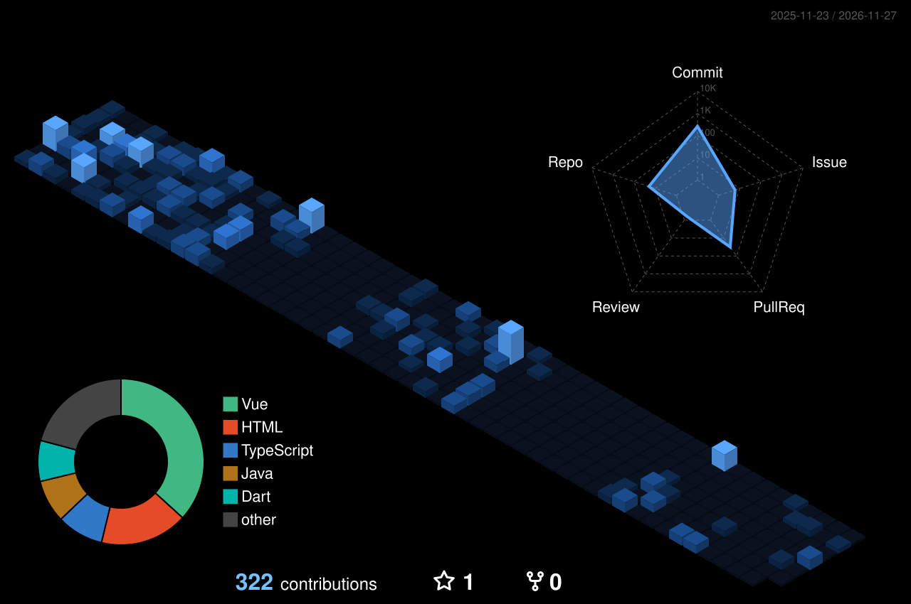

  

<h1 align="center">Hello 👋, I'm BUN Sengleang</h1>
<h3 align="center">Full-Stack Developer</h3>

  

  

---

## 👨‍💻 About Me

- 🔭 Currently working on: **Full-Stack Web & Mobile Applications**
- 🌱 Currently learning: **NestJS, DevOps & Docker, and AI**
- 💡 Interested in: **System Design, Operating Systems, Web Development, & Mobile Apps**
- 🎯 Goal: **Becoming a Professional Software Engineer**
- 🌟 Always exploring new technologies and best practices

---

## 🛠️ Tech Stack

---

## 📊 Most Used Languages

---

## 📈 GitHub Stats

## 🚀 GitHub Contribution

---

## 📬 Contact Me

- 🌐 Portfolio: [bsengleang.me](https://githetrunk.github.io)
- 🐙 GitHub: [GitheTrunk](https://github.com/GitheTrunk)
- 💼 LinkedIn: [Bun Sengleang](https://www.linkedin.com/in/bun-sengleang/)
- 📬 Email: **bsengleang@gmail.com**
- 📧 Feel free to reach out for collaborations!

---

<h2 align="center">
Thanks for visiting my profile 🚀
</h2>

  

